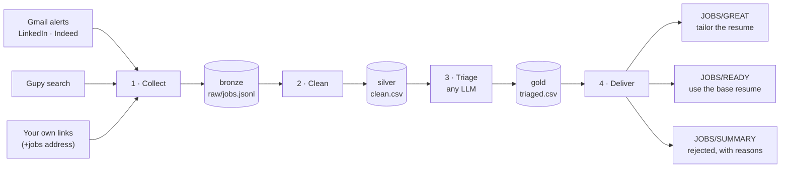

# 🚀 HireLLMe — LLM-Powered Job Triage Pipeline for Gmail, LinkedIn, Indeed and Gupy

[](https://github.com/costakevinn/HireLLMe/actions/workflows/tests.yml)

**HireLLMe** is an end-to-end data pipeline that turns a flood of job alerts into a short, organized list of openings worth applying to. It collects job alerts from Gmail (LinkedIn and Indeed) and searches Gupy, cleans and deduplicates them in layers, uses an LLM to triage each opening against a candidate profile, and delivers one email per job into Gmail labels, telling which resume to use. It runs on its own every day on GitHub Actions, with any LLM: a Claude plan, a paid API or a free tier.

The application itself is always made by a person: the pipeline finds, filters and prepares, never applies.

**Author:** Kevin Mota da Costa

**Portfolio:** https://costakevinn.github.io

**LinkedIn:** https://linkedin.com/in/costakevinnn

---

## 📊 Results

First full run over two weeks of alerts (November 2026):

| Stage | Volume |
|---|---|
| Alert emails read | 45 (LinkedIn and Indeed) + Gupy search |
| Raw job postings (bronze) | 468 — LinkedIn 310, Indeed 46, Gupy 112 |
| Unique jobs (silver) | 316 — 152 duplicates removed (32%), 46 of them the same job across sources |
| LLM triage (gold) | 316 / 316 valid decisions in 8 requests of up to 40 jobs |
| Delivered to Gmail | **33 great**, **172 ready to apply**, 111 rejected (one summary email) |
| End-to-end time | about 10 minutes |

Daily runs after that process only what is new: a typical run takes about 20 seconds and sends the LLM only the openings it has never seen.

---

## 💡 What This Project Demonstrates

- **Data engineering:** layered pipeline (bronze → silver → gold), append-only raw layer, incremental processing, deduplication within and across sources
- **LLM engineering:** provider-independent LLM layer (Claude plan, Anthropic API, any OpenAI-compatible API), structured JSON output validated in code, batching, token accounting, a per-run budget, and failures that never lose data
- **Integration:** Gmail over IMAP (read, relabel, create messages), a REST search API, parsing of several email formats, tracking-link decoding
- **Orchestration:** Docker, one command per step, GitHub Actions on a schedule, a watchdog that reruns missed runs, state committed back to a private repository
- **Reliability:** idempotent steps, a small taxonomy of errors with one reaction each, retries, email notices, dry runs before anything is changed, automated tests in CI
- **Security:** secrets only in `.env` and GitHub Secrets, login tokens in alert links never stored, personal data kept out of the public repository

---

## 🧠 How It Works



1. **Collect** — reads the `JOBS` label (the queue of unprocessed alerts), extracts every job, stores it in the raw layer and moves the email to `JOBS/PROCESSED`; also searches Gupy for postings published since the last run.
2. **Clean** — rebuilds the clean table from scratch: one row per link, excluded titles removed, the same job from different sources merged by company + title.
3. **Triage** — checks that the LLM is available, then sends only the jobs never evaluated, newest first, with the candidate profile; each job gets a category (great / normal / rejected), a resume, a language and a one-line reason.
4. **Deliver** — creates one email per job directly in a Gmail label (not in the inbox, no notification), with the resume to use in the subject: `[data · EN] Data Engineer · Company · City`.

---

## 📐 Design Choices

| Choice | Why |
|---|---|
| Append-only raw layer | Everything collected is kept; any later layer can be rebuilt from it |
| The Gmail label is the queue | An alert leaves `JOBS` once processed, so the next run simply reads what is left |
| Write first, then move emails | If a run stops in the middle, nothing is lost and nothing is duplicated (emails are recognized by Message-ID) |
| Transient vs. permanent errors | Network failures are retried on the next run; unknown formats go to `JOBS/MANUAL`, unread, for a human |
| Stable job id (hash of the link) | The LLM never evaluates the same job twice, and no job is delivered twice |
| One LLM interface, four error kinds | Every provider failure becomes *setup*, *limit*, *transient* or *output*, and each kind has one reaction (see [Limits and failures](#limits-and-failures)) |
| A queue that never expires | A job waits until it is triaged, newest first; nothing is dropped because a plan or quota ran out |
| A cutoff on the first run only | An inbox full of old alerts does not become hundreds of stale jobs; later runs read everything new |
| Your choice wins | A job you send yourself is never rejected, and a tag in the subject sets its label and resume |
| Profile written in Markdown | The filter is tuned by editing a text file, not code |
| Small model, 40 jobs per request | Triage is a simple task; a small model in batches keeps usage low |
| "When in doubt, normal" | Many alerts carry only title, company and location; the filter never rejects for lack of information |
| Every user-facing text in the config | Labels, email texts and the language of the LLM's reasons can be changed (or translated) without touching code |
| Indeed job id decoded offline | Most Indeed links carry the job id, or the destination compressed inside; no request is needed |
| Clean links only | LinkedIn alert links contain a login token; only `linkedin.com/jobs/view/<id>` is stored |

---

## 🗂 Data and Structure

```
HireLLMe/
├── scripts/                 # The pipeline (Python standard library only)
│   ├── collect.py           #   1 · collect
│   ├── clean.py             #   2 · clean
│   ├── triage.py            #   3 · triage with the LLM
│   ├── deliver.py           #   4 · deliver to Gmail
│   ├── pipeline.py          #   run the four steps (used by GitHub Actions)
│   ├── llm.py               #   one interface for every LLM provider
│   ├── sources.py           #   parsers: LinkedIn, Indeed, Gupy, your own links
│   ├── gmail.py             #   Gmail over IMAP
│   ├── notify.py            #   notice emails (failed runs, triage problems, token expiry)
│   ├── common.py            #   paths, config, time, JSONL and CSV
│   └── purge.py · reset.py  #   maintenance tools (dry run unless --yes)
├── prompts/triage.md        # Instructions for the LLM
├── data/                    # Your data (ignored by Git); each file has a .example
│   ├── config.json          #   sources, labels, search terms, LLM, budget, email texts
│   ├── profile.md           #   your profile and the triage rules
│   ├── raw/                 #   bronze: jobs.jsonl, runs.jsonl, triage.jsonl (tokens per run)
│   ├── clean.csv            #   silver
│   └── triaged.csv          #   gold
├── tests/                   # Unit tests (no internet, Gmail or LLM)
├── .github/workflows/       # Tests on every push; scheduled pipeline; watchdog
├── Dockerfile · docker-compose.yml · run.sh · build_run.sh
└── docs/                    # Technical documentation (PDF)
```

**Known limitations:** LinkedIn alerts carry only title, company and location, so those jobs are triaged with less information; sponsored Indeed jobs carry no job id, so their email link is kept as it is; the Gupy search is the public portal's endpoint, not an official API, and may change; the parsers depend on the alert email formats; the LLM can make mistakes, which is why rejections are listed with their reasons in a summary email.

---

## 🛠 Tech Stack

**Programming**
- Python (standard library only)

**LLM**
- Claude Haiku via Claude Code in headless mode (Claude Pro/Max plan)
- Anthropic API, or any OpenAI-compatible API: OpenAI, Gemini, Groq, OpenRouter, Ollama
- Prompt design, structured JSON output, validation, token accounting

**Data**
- JSONL and CSV layers (bronze, silver, gold)
- ETL, deduplication, incremental processing

**Integration**
- Gmail (IMAP), Gupy search API, email parsing

**Engineering**
- Docker / Docker Compose
- GitHub Actions (CI, scheduled runs, watchdog)
- Git / GitHub
- Linux

---

## ▶ Usage

### Requirements

- Docker
- A Gmail account with 2-Step Verification on
- An LLM: a Claude Pro or Max plan, **or** an API key (Gemini and Groq have free tiers)
- A GitHub account and the `gh` CLI (only for running it every day in the cloud)

### 1. Get the project and create your files

```bash
git clone https://github.com/costakevinn/HireLLMe.git
cd HireLLMe
cp .env.example .env
cp data/config.json.example data/config.json
cp data/profile.md.example data/profile.md
```

Edit `data/profile.md`: who you are, your resumes and what makes a job great, normal or rejected. The LLM reads this file on every run. It can be written in any language.

In `data/config.json`:

| Key | What it sets |
|---|---|
| `sources` | which sources are on: `linkedin`, `indeed`, `gupy`, `manual` |
| `gmail` | the label names (and `server`, if not Gmail) |
| `collect.first_run_days` | how far back the **first** run reads (default 14 days, see below) |
| `indeed.domain` | the Indeed site of your country, e.g. `br.indeed.com`, `www.indeed.com` |
| `gupy.search_terms` | what to search on Gupy (Brazil) |
| `triage` | the LLM, the budget, your resume names and languages, the language of the reasons |
| `manual` | the subject tags for jobs you send yourself, and the text that starts their reason |
| `messages` | any email text, to read everything in another language (see `MESSAGES` in `scripts/deliver.py` and `scripts/notify.py`) |

**The first run.** Your inbox may hold weeks of old alerts. On the first run (when `data/raw/runs.jsonl` is still empty) only the last `first_run_days` days are read; older alerts are only moved to `JOBS/PROCESSED`, without becoming jobs. After that, every run reads everything new, whatever its age, so nothing is missed if a run is skipped.

### 2. Set up Gmail

1. Create an **app password**: [myaccount.google.com/apppasswords](https://myaccount.google.com/apppasswords). Put your email and the 16-letter password (without spaces) in `.env` (`GMAIL_USER`, `GMAIL_APP_PASSWORD`). Changing your Google password revokes app passwords: create a new one if that happens.
2. Turn on **job alerts** on LinkedIn and Indeed, sent to that email.
3. Choose how alerts reach the queue:
   - **With filters** (recommended): in Gmail, create the label **`JOBS`** and one filter per sender below, applying the label, *Skip the inbox* and *Never send it to Spam*.
   - **Without filters** (handy on a phone, where Gmail cannot create filters): set `"inbox": "INBOX"` and list the senders in `config.json`; only those messages are read, and processed alerts are archived.
     ```json
     "gmail": { "inbox": "INBOX", "senders": ["jobalerts-noreply@linkedin.com", "jobalert.indeed.com", "match.indeed.com"], ... }
     ```
   The senders: `jobalerts-noreply@linkedin.com`, `donotreply@jobalert.indeed.com`, `donotreply@match.indeed.com`.
4. *(Optional)* To add jobs you find yourself, create one more filter for `to:youremail+jobs@gmail.com` with the label `JOBS`, and send the job link to that address **from the same account** (see [Sending jobs yourself](#sending-jobs-yourself)).

The other labels (`JOBS/PROCESSED`, `JOBS/MANUAL`, `JOBS/GREAT`, `JOBS/READY`, `JOBS/SUMMARY`) are created automatically.

### 3. Connect an LLM

Choose a provider in `config.json` (`triage.provider`, `triage.model`, `triage.base_url`). A chat subscription is not API access: ChatGPT Plus or the Gemini app do not include an API key. The Claude plan is the exception, through Claude Code.

| Provider | `provider` | `model` (example) | `base_url` | Key in `.env` |
|---|---|---|---|---|
| Claude Pro/Max plan | `claude-code` | `haiku` | — | `CLAUDE_CODE_OAUTH_TOKEN` |
| Anthropic API | `anthropic` | `claude-haiku-5-5` | — | `LLM_API_KEY` |
| Gemini (free tier) | `openai-compatible` | `gemini-2.5-flash` | `https://generativelanguage.googleapis.com/v1beta/openai` | `LLM_API_KEY` |
| Groq (free tier) | `openai-compatible` | `llama-3.3-70b-versatile` | `https://api.groq.com/openai/v1` | `LLM_API_KEY` |
| OpenAI | `openai-compatible` | `gpt-4o-mini` | `https://api.openai.com/v1` | `LLM_API_KEY` |
| OpenRouter | `openai-compatible` | any listed model | `https://openrouter.ai/api/v1` | `LLM_API_KEY` |
| Ollama (local only) | `openai-compatible` | any pulled model | `http://localhost:11434/v1` | — |

Model names change; check your provider's list.

**With the Claude plan:**

```bash
./build_run.sh
docker compose run --rm app claude setup-token
```

Approve in the browser, then add the printed token (`sk-ant-oat01-...`) to `.env` as `CLAUDE_CODE_OAUTH_TOKEN`, and write today's date in `triage.token_created`: the token lasts one year, and you get an email 30, 7 and 1 day(s) before it expires. Never set `ANTHROPIC_API_KEY`: it would switch Claude Code to the paid API.

**Check that the LLM answers** (a one-word request, no jobs sent):

```bash
./run.sh triage --check         # "LLM ok: claude-code / haiku", or what is wrong
```

### 4. Run it

```bash
./run.sh collect --dry-run      # what would be collected (nothing written or moved)
./run.sh pipeline               # collect -> clean -> triage -> deliver
```

Each step also runs on its own (`./run.sh collect`, `clean`, `triage`, `deliver`), and most accept `--dry-run` or `--limit N` (only N jobs, to test).

```bash
docker compose run --rm app python -m unittest discover -s tests -v   # tests
./run.sh purge                  # alerts older than 14 days -> Gmail trash (dry run unless --yes)
./run.sh reset                  # back to the initial state, for testing (dry run unless --yes)
```

### 5. Run it every day on GitHub Actions

The workflow in `.github/workflows/pipeline.yml` runs the pipeline twice a day (**04:07** and **13:17**, Brasília time; edit the `cron` lines for yours). GitHub sometimes delays or skips scheduled runs, so `watchdog.yml` checks an hour later, starts the run again if needed and emails you. Your data must live in a **private** repository, because the workflow reads your profile and commits the history back after each run.

```bash
# 1. a private copy of the project, with your data
cp -r HireLLMe HireLLMe-prod && cd HireLLMe-prod && rm -rf .git
```

In the copy, edit `.gitignore` and **keep only** `.env`, `__pycache__/` and `*.pyc`, so the files in `data/` are committed. Then:

```bash
# 2. create the private repository
git init -b main && git add -A && git commit -m "HireLLMe in production"
gh repo create HireLLMe-prod --private --source=. --push

# 3. secrets (read from your .env, never printed) and the switch that enables the workflow
grep -E '^(GMAIL_USER|GMAIL_APP_PASSWORD|CLAUDE_CODE_OAUTH_TOKEN|LLM_API_KEY)=' .env > /tmp/secrets.env
gh secret set -f /tmp/secrets.env && rm /tmp/secrets.env
gh variable set HIRELLME_ENABLED --body true

# 4. first run, by hand, and follow it
gh workflow run pipeline.yml && sleep 5 && gh run watch
```

The workflow only runs where `HIRELLME_ENABLED` is `true`, so it never runs on the public repository. Also turn on GitHub's own email for failed workflows (GitHub → Settings → Notifications → Actions): it reaches you even if Gmail itself refuses the login.

### Limits and failures

Plans and free tiers have limits, and providers go down. The pipeline is built so that this only delays jobs, never loses them:

| What happens | Kind | What the pipeline does |
|---|---|---|
| Key missing, invalid or expired; unknown model | `setup` | Stops the triage and emails you right away |
| Rate limit, plan limit, free quota used up | `limit` | Stops the triage; the jobs wait for the next run. Emails you only after `alert_after_runs` runs in a row (default 3) |
| Timeout, provider down | `transient` | Tries twice more, then treats it like a limit |
| Answer out of format | `output` | Splits the batch in two and asks again; a job that still fails alone is delivered as *not triaged* |

- Before any batch, a one-word health check: if the provider is not available, nothing is sent.
- `max_jobs_per_run` (0 = no limit) caps how many jobs go to the LLM per run, for small free tiers.
- `deliver_untriaged_after_days` (0 = off) delivers a job without a decision, marked *not triaged*, when it has waited longer than that. No tokens are spent on it.
- Every run appends a line to `data/raw/triage.jsonl`: jobs sent and decided, tokens used, and why it stopped.

### Sending jobs yourself

Found a job on your own? Email the link to your `+jobs` address, from your account. It enters the next run, before every other job, and **is never rejected**. Write the subject as `title · company · location` (`|` also works; company and location are optional) and add tags anywhere in it:

| Subject | Result |
|---|---|
| `Data Scientist · Acme · Remote` | the LLM chooses between great and ready, and picks the resume |
| `#great Data Scientist · Acme · Remote` | `JOBS/GREAT`; the LLM only picks the resume and writes the reason |
| `#ready #data Data Engineer · Acme` | `JOBS/READY`, with the `data` resume |

The more the subject says, the better the LLM's choice of resume and reason, and the easier it is to merge the job with the same one from an alert.

The tags are set in `config.json` (`manual.great_tags`, `manual.ready_tags`; any resume name works as a resume tag). With a label tag, the job is delivered even when the LLM is not available. Sending a job that was already triaged (for example, one the filter rejected) delivers it again with your choice.

### Daily use

| Label | What to do |
|---|---|
| `JOBS/READY` | Open the link, attach the resume shown in the subject, apply, delete the email |
| `JOBS/GREAT` | Tailor the resume for the job, apply, delete the email |
| `JOBS/SUMMARY` | Check now and then that no good job was rejected; if one was, adjust `profile.md` |
| `JOBS/MANUAL` | Alerts the parser did not understand |

---

## 🤝 Responsible Use

- HireLLMe reads **only your own email**: the alerts LinkedIn and Indeed already send you. It does not log in to, crawl or scrape LinkedIn or Indeed.
- To get an Indeed job id, it follows the redirect of the link in your alert (it does not open the job page), and keeps the email link when Indeed declines. `"indeed": {"resolve_links": false}` turns this off.
- The Gupy search is the same public search the website uses, a few requests per run with a pause between them.
- It **never applies** to anything. Every application is made, and every resume chosen, by a person.
- You are responsible for your own instance and for following the terms of the services you use.

---

## 📄 Documentation

Technical documentation (sources, pipeline layers, LLM triage, delivery, orchestration, security, results): [`docs/HireLLMe_documentation.pdf`](docs/HireLLMe_documentation.pdf)

---

## 🌐 Portfolio

This project is part of my Machine Learning portfolio:
👉 https://costakevinn.github.io

---

## License

MIT License — see `LICENSE` for details.